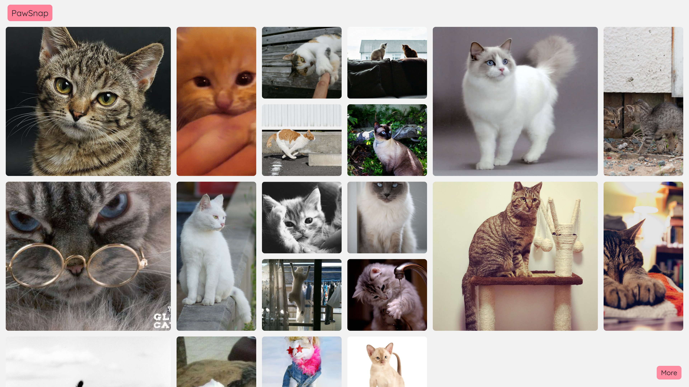
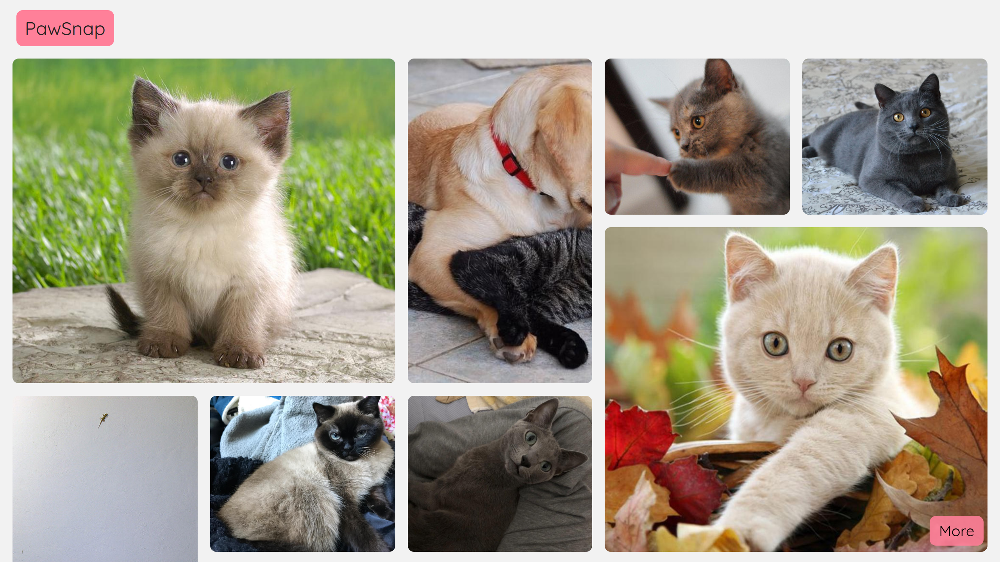
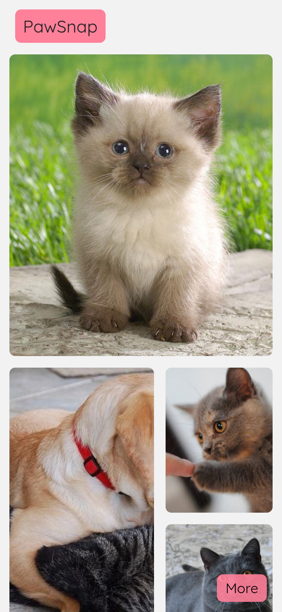
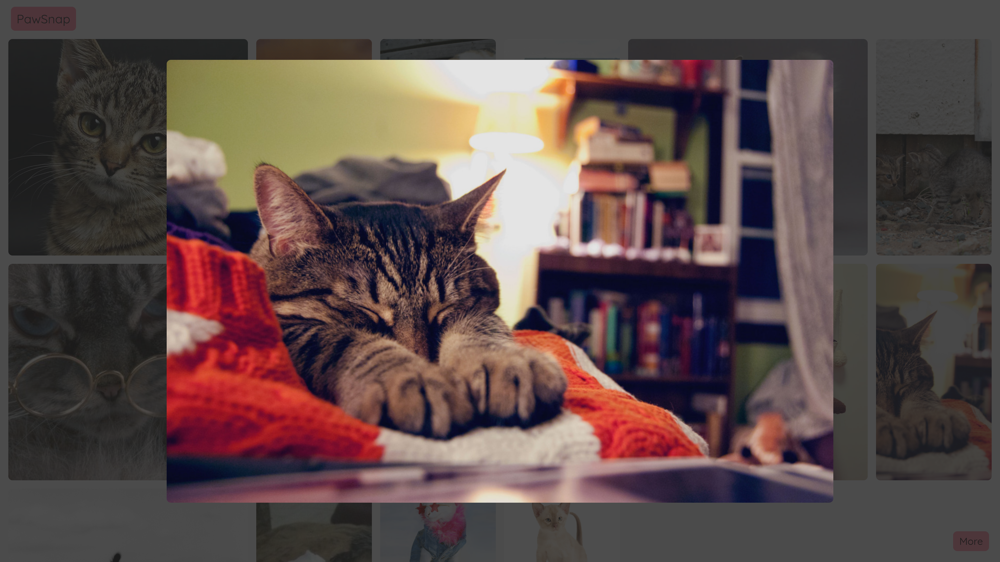

# 🐾 PawSnap

PawSnap is a clean, responsive image gallery web application that showcases random cat photos fetched dynamically from **The Cat API**. 

---

## Overview & Features

* **Dynamic Cat Gallery:** Fetches high-quality cat images directly from The Cat API.
* **Responsive Masonry Grid:** Adapts seamlessly across mobile, tablet, and desktop viewports.
* **Interactive Modal Preview:** Click on any image to open a full-resolution modal preview.
* **Load More:** Easily append more cat pictures to the gallery with a single click.

---

## Layout & Previews

### Desktop View

### Banner & Layout

### Mobile Layout & Modal Preview
| Mobile View | Image Preview Modal |
| :---: | :---: |
|  |  |

---

## 🛠️ Built With

* **React** – Component-based UI structure & state management
* **The Cat API** – Dynamic image data source
* **CSS Grid / Flexbox** – Responsive layout design

